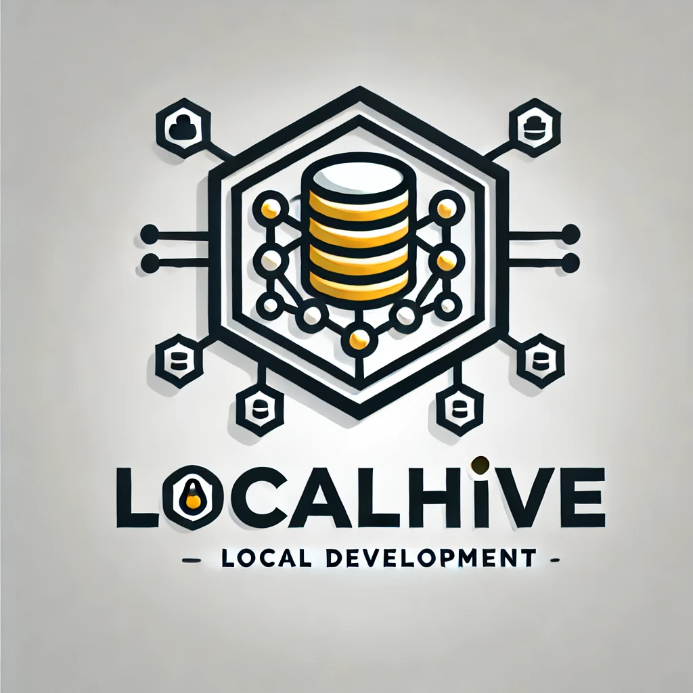

# LocalHive


## Overview
<!-- GitAds-Verify: 5KRHCPVETXL6RMR2RW33G9FXPVY1IRXK -->



**LocalHive** is a powerful development tool designed to streamline local application development. It provides a fully functional local S3 bucket and versatile database connectors, empowering developers to manage and analyze their data with ease. Written in C++, LocalHive is robust, efficient, and future-focused, enabling seamless integration with your projects.

## Documentation

The native C++17 implementation is being developed in phases. These documents define its architecture, contracts, supported S3 surface, migration plan, and verification approach:

- [Architecture](docs/architecture.md)
- [Implementation contracts](docs/implementation-contracts.md)
- [S3 storage and durability specification](docs/s3-storage-contracts.md)
- [S3 compatibility matrix](docs/s3-compatibility-matrix.md)
- [Migration plan](docs/migration-plan.md)
- [Requirements traceability matrix](docs/requirements-traceability-matrix.md)
- [Testing strategy](docs/testing-strategy.md)

## Features

- **Local S3 Bucket**: Access and manage a fully functional local S3 bucket for your development needs.
- **Database Connectors**: Seamlessly connect to multiple databases including:
  - MongoDB
  - SQLite
  - Redis
  - MySQL
  - PostgreSQL
  - Cassandra
  - MariaDB
- **Data Operations**:
  - Store images and Videos in Buckets
  - Search, create, and edit database tables.
  - Visualize database processes through interactive graphical analytics.
- **Future Plans**: UI-based frontend-backend integration without requiring manual Models, Views, and Controllers.

## Installation

### Prerequisites
- **Operating System**: Windows, macOS, or Linux
- **Dependencies**:
  - C++ Compiler (e.g., GCC, Clang, or MSVC)
  - MongoDB, SQLite, Redis (optional: other database clients)

### Steps
1. Clone the repository:
   ```bash
   git clone https://github.com/Arison99/LocalHive.git
   ```
2. Navigate to the project directory:
   ```bash
   cd LocalHive
   ```
3. Build the project:
   ```bash
   cmake .
   make
   ```
4. Run the application:
   ```bash
   ./LocalHive
   ```

## Usage

LocalHive exposes an S3-compatible REST endpoint. Applications can use either
HTTP or HTTPS, depending on the endpoint configuration. HTTP is convenient for
local development; HTTPS is appropriate when TLS is enabled for the service or
provided by a reverse proxy.

### HTTP and HTTPS endpoints

Use path-style S3 requests with an endpoint such as:

```text
http://localhost:8080/bucket-name/object-key
https://localhost:8443/bucket-name/object-key
```

Virtual-hosted requests are also supported by the native router:

```text
http://bucket-name.localhost:8080/object-key
https://bucket-name.localhost:8443/object-key
```

### AWS CLI

Configure a local profile, then direct standard AWS CLI commands to the
LocalHive endpoint:

```bash
aws configure set aws_access_key_id "localhive-dev" --profile localhive
aws configure set aws_secret_access_key "localhive-secret" --profile localhive
aws configure set region "us-east-1" --profile localhive

aws --endpoint-url=http://localhost:8080 --profile localhive s3 mb s3://demo
aws --endpoint-url=http://localhost:8080 --profile localhive s3 cp ./report.pdf s3://demo/report.pdf
aws --endpoint-url=http://localhost:8080 --profile localhive s3 ls s3://demo
aws --endpoint-url=http://localhost:8080 --profile localhive s3 cp s3://demo/report.pdf ./downloaded-report.pdf
```

For HTTPS, change the endpoint URL to the configured HTTPS address. If using a
development certificate, configure the CLI with its trusted CA certificate.

### Application SDKs

S3 SDKs work by setting their endpoint URL and credentials. For example, with
Python Boto3:

```python
import boto3

s3 = boto3.client(
    "s3",
    endpoint_url="http://localhost:8080",
    aws_access_key_id="localhive-dev",
    aws_secret_access_key="localhive-secret",
    region_name="us-east-1",
)

s3.create_bucket(Bucket="demo")
s3.put_object(Bucket="demo", Key="hello.txt", Body=b"Hello from LocalHive")
print(s3.get_object(Bucket="demo", Key="hello.txt")["Body"].read())
```

The planned `localhive-admin` CLI manages the service and its operational
settings. See the [implementation contracts](docs/implementation-contracts.md)
for its control-plane design.

## Contributing
We welcome contributions! Please:
1. Fork the repository.
2. Create a feature branch.
3. Submit a pull request.

## Roadmap
- Design an S3 Bucket
- Allow creation of newBuckets
- Add & implement User Authentication with Administration Rights
- Create & add DB_Connectors for different Databases
- Design Backend APIs for the S3 Bucket & DB_Connectors
- Design UIs ( frontends )
- Handle Data_Requests from the frontend (Webpages or Desktop App)
- Build components for data display 
- Fetch and handle backend processes for analysis
- Build APIs for Data_Analytics
- Enhance graphical analytics with real-time monitoring.
- Introduce frontend-backend integration via a no-code UI.
- Support additional databases.
- Provide Docker-based deployment for simplified setup.

## License
This project is licensed under the [MIT License](LICENSE).

## Contact
- **Author**: [Arison99](mailto:harrisondaviinci@gmail.com)
- **GitHub**: [Arison99](https://github.com/Arison99/LocalHive)

  
[](https://gitads.dev/v1/ad-track?source=arison99/localhive@github)


---
This documentation is still under progress, so that implies more information about this product will be added during the development process 

Let LocalHive simplify your development process and make local development as seamless as possible!
