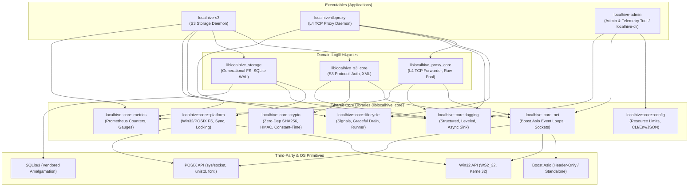
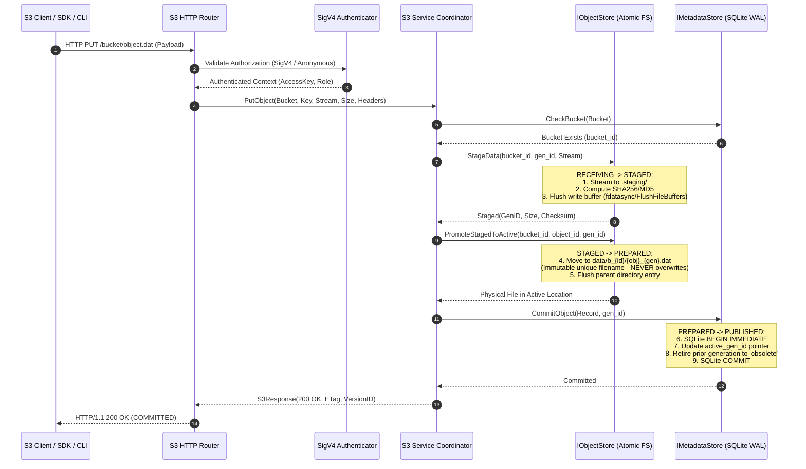
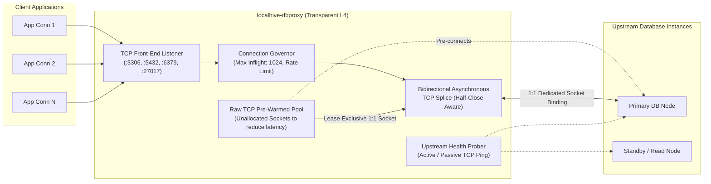
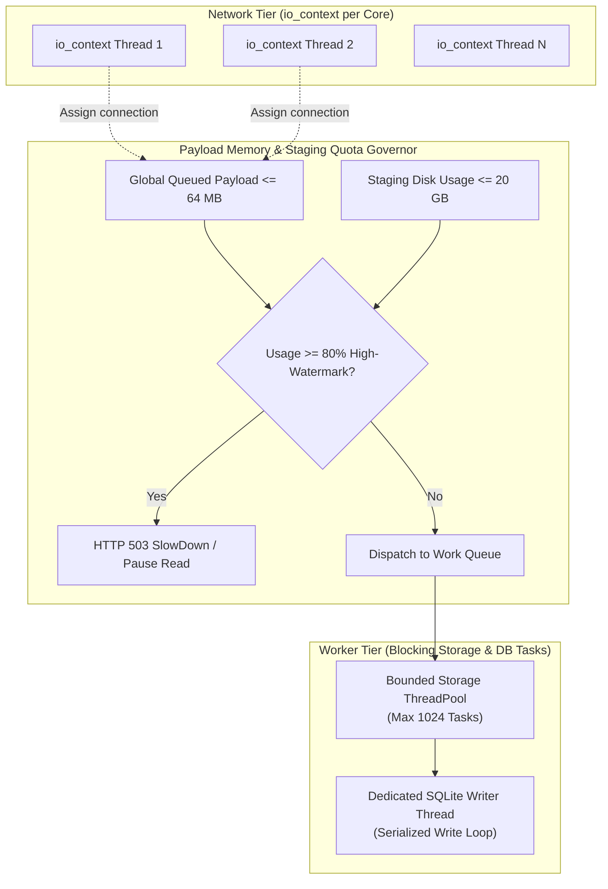

# LocalHive Platform Architecture Specification
**Document ID:** `DOC-LH-ARCH-002-REV3`  
**Task Reference:** `TASK LH-ARCH-002` (Architecture Contract Closure)  
**Date:** 2026-10-12  
**Status:** Authoritative Engineering Architecture

---

## 1. System Vision & Architectural Scope

LocalHive is designed as a modular native C++17 infrastructure platform providing local developers and CI/CD pipelines with production-grade data primitives:
1. **LocalHive S3 (`localhive-s3`):** A lightweight, highly resilient local object store targeting **S3 API Compatibility** (standard HTTP REST methods, SigV4 authentication, XML envelopes, and AWS SDK/CLI interoperability).
2. **LocalHive DB Proxy (`localhive-dbproxy`):** An independent, low-overhead L4 TCP connection forwarder and session governor for relational and document databases.
3. **LocalHive Admin / CLI (`localhive-admin`):** An out-of-band operational interface for configuration, telemetry inspection, and health verification.

> [!IMPORTANT]
> **API Compatibility vs. Universal Equivalence:**  
> LocalHive targets wire-level **S3 API Compatibility** for developer workflows. It makes no claims of universal AWS S3 operational equivalence (such as global replication, erasure-coded distributed clusters, or petabyte-scale consistency models).

### Core Architectural Principles
* **Strict Decoupling:** S3 object storage logic and database proxy logic must never depend on each other. Neither service shall import headers or link libraries belonging to the other's domain.
* **Separation of Control and Data Paths:** Administrative operations, metrics scraping, and configuration reloads occur out-of-band without acquiring locks or injecting latency into the hot I/O data path.
* **Native Portability Without Mandatory Containers:** Windows is the primary development environment (MSVC / MinGW); Linux is the production/CI environment (GCC / Clang / systemd).
* **Layered & Bounded Concurrency:** Dedicated asynchronous event loops (`io_context`-per-thread) with bounded memory and disk quotas manage network I/O, while bounded background worker pools execute blocking filesystem and SQLite transactions.

---

## 2. Component Topology & Dependency Direction

The LocalHive platform adopts a strictly acyclic, layered architecture. Lower layers have zero knowledge of higher layers.

### Dependency Rules & Constraints
1. **No Lateral Dependencies:** `liblocalhive_s3_core` and `liblocalhive_proxy_core` are completely isolated. Neither depends on the other.
2. **Strict Downward Dependency:** Domain libraries depend solely on `liblocalhive_core` and designated third-party libraries (e.g. SQLite for `liblocalhive_storage`).
3. **Core Independence:** `liblocalhive_core` has no dependencies on any domain logic. It encapsulates only reusable OS abstractions, networking primitives, cryptographic functions, and diagnostic tools.

---

## 3. Subsystem Architecture

### 3.1. LocalHive Core (`liblocalhive_core`)

| Module | Namespace | Responsibilities & Design |
| :--- | :--- | :--- |
| **Lifecycle** | `localhive::core::lifecycle` | Service execution lifecycle (`ServiceRunner`), signal trapping (`SIGINT`, `SIGTERM`, Windows Console Ctrl handlers), cancellation tokens (`std::atomic_bool`), and orderly phased shutdown. |
| **Configuration** | `localhive::core::config` | Strongly-typed configuration structures, command-line parsing, environment variable overrides (`LOCALHIVE_*`), and JSON file deserialization with semantic validation. |
| **Logging** | `localhive::core::logging` | Asynchronous, lock-free ring-buffered logging. Supports structured JSON and human-readable console sinks with compile-time level filtering (`TRACE`, `DEBUG`, `INFO`, `WARN`, `ERROR`, `FATAL`). Sensitive-data redaction. |
| **Metrics** | `localhive::core::metrics` | Lock-free counters, atomic gauges, and histogram buckets. Prometheus text format serialization via an out-of-band HTTP or pipe endpoint. |
| **Networking** | `localhive::core::net` | Boost.Asio Thread-per-Core Event Loop Pool (`io_context`-per-thread), TCP socket wrappers, buffered stream adapters, and socket option helpers (TCP_NODELAY, SO_KEEPALIVE, SO_REUSEADDR). |
| **Security / Crypto** | `localhive::core::crypto` | **Zero external dependencies.** Self-contained C++17 implementation of SHA-256 (RFC 6234) and HMAC-SHA256 (RFC 4231), timing-safe byte equality, and hex/base64 encoders. Optional compiler intrinsics for hardware SHA-NI. |
| **Platform Abstraction** | `localhive::core::platform` | Windows vs. Linux unified abstractions for file locking (`LockFileEx` vs `fcntl`), atomic file replacement (`ReplaceFileW` vs `renameat2`), directory sync, and high-resolution monotonic clocks. |

---

### 3.2. LocalHive S3 Subsystem (`localhive-s3`)

The S3 daemon implements S3 REST API compliance backed by an atomic filesystem and SQLite metadata engine:

#### Key Architecture Components:
* **Normative 5-State Object Lifecycle:** Strictly enforces `RECEIVING` $\to$ `STAGED` $\to$ `PREPARED` $\to$ `PUBLISHED` $\to$ `COMMITTED`. Physical files are moved to their unique destination before SQLite metadata commit, guaranteeing Invariant 4.
* **HTTP / S3 Protocol Handler:** Parses standard HTTP/1.1 requests supporting both **Path-Style** (`http://localhost:8080/bucket/key`) and **Virtual-Hosted-Style** (`http://bucket.localhost:8080/key`). Enforces AWS XML schema compliance for responses and errors.
* **Authentication Subsystem (`SigV4`):** Parses `Authorization: AWS4-HMAC-SHA256` and presigned URLs. Computes HMAC signatures using zero-dependency `localhive::core::crypto` and verifies signatures in constant time.
* **Storage Engine (`liblocalhive_storage`):**
  * `IObjectStore`: Content-addressable generational filesystem store.
  * `IMetadataStore`: SQLite 3 embedded database operating in WAL mode with configurable durability profiles (`Strict`, `Standard`, `Development`).

---

### 3.3. LocalHive DB Proxy Subsystem (`localhive-dbproxy`)

The DB Proxy daemon runs as a standalone native binary that manages client connection lifecycles, mitigates database exhaustion, and proxies TCP traffic to upstream databases.

#### Phase 1 L4 Forwarding Guarantees:
1. **Transparent L4 TCP Stream Forwarding:**
   * Strict 1:1 client-to-upstream socket binding. Zero payload inspection.
   * Asynchronous bidirectional splicing with socket backpressure (pauses reading from downstream when upstream write buffer fills).
   * Proper TCP half-close propagation (client `FIN` maps to upstream `FIN`).
   * Connection pre-warming: pre-establishes raw, unallocated TCP connections to eliminate connect handshake latency. Once allocated, connection is strictly exclusive.
   * **Failover Safety:** No automatic primary failover. Dropped upstream connections reset client sockets immediately.
2. **Protocol-Aware Pooling & Multiplexing (Future / L7):**
   * Requires parsing wire protocols (PostgreSQL, MySQL, Redis, MongoDB).
   * Deferred to post-v1.0 to prevent transaction boundary corruption.
   * **Explicit Constraint:** SQLite is an in-process C library and is **never** an upstream network proxy target.

---

### 3.4. LocalHive Admin & Control Plane (`localhive-admin`)

Administrative capabilities are strictly separated from high-throughput data paths:

1. **Security & Transport:**
   * **Windows:** Named Pipe (`\\.\pipe\localhive-s3-admin`) protected by an explicit Win32 DACL granting access solely to `BuiltinAdministrators` and `LocalSystem`.
   * **Linux:** Unix Domain Socket (`/var/run/localhive/s3-admin.sock`) with file permissions `0600` owned by `localhive:localhive`.
   * **Loopback HTTP:** Binds exclusively to `127.0.0.1:9090`. Requires `Authorization: Bearer <token>` loaded from a mode `0400` secret file.
2. **Capabilities:**
   * Query server runtime statistics (active connections, open reader leases, SQLite WAL size).
   * Dynamic log-level adjustment without restarting the process.
   * Command graceful connection draining (stop accepting new sockets, allow in-flight S3 streams or DB queries to terminate within a timeout).

---

## 4. Concurrency & Threading Model

LocalHive implements an event-loop-per-core model with bounded worker pools, payload memory limits, and explicit backpressure:

1. **Network Event Loop Pool:** `io_context` instances equal to physical CPU cores. Connections pinned to a single loop, eliminating lock overhead.
2. **Memory & Disk Governors:** Payload buffers bounded globally to 64 MB; staging disk bounded to 20 GB. High-watermark (80%) triggers HTTP 503 `SlowDown`.
3. **SQLite Serialized Worker:** Dedicated writer thread executes `BEGIN IMMEDIATE` transaction loops with bounded 5,000 ms busy-timeout handling.
