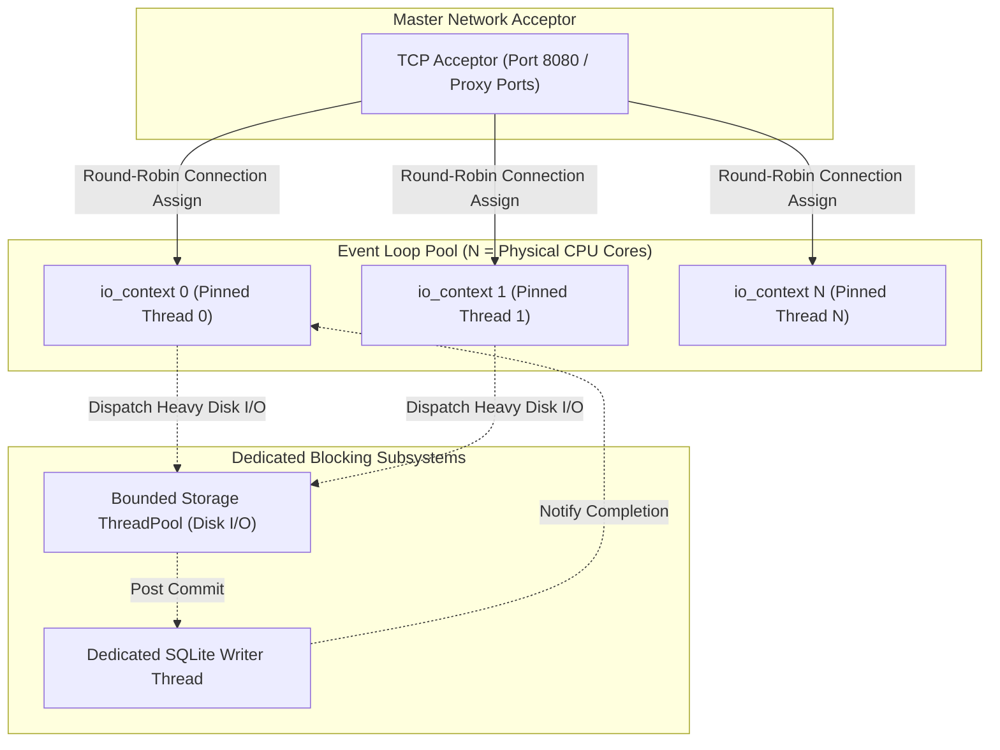
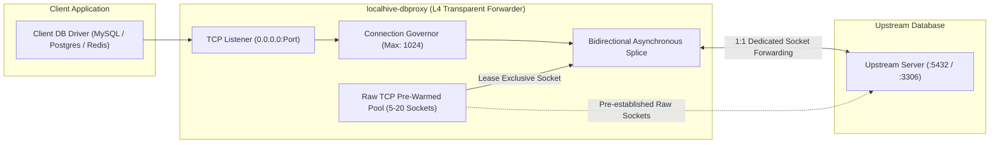

# LocalHive Implementation Contracts & Interfaces
**Document ID:** `DOC-LH-CONTRACT-003-REV3`  
**Task Reference:** `TASK LH-ARCH-002` (Contract Closure)  
**Date:** 2026-10-12  
**Status:** Normative Engineering Contract

---

## 1. Universal System Primitives & Cross-Cutting Contracts

### 1.1. Error Model & Result Type
LocalHive rejects unstructured exceptions across subsystem boundaries. All public interface boundaries return an explicit, non-throwing `Result<T, Status>` or `Status` object modeled on standard monadic result semantics.

```cpp
namespace localhive::core {

enum class StatusCode : uint16_t {
    Ok = 0,
    InvalidArgument,
    NotFound,
    AlreadyExists,
    PermissionDenied,
    ResourceExhausted,
    FailedPrecondition,
    Aborted,
    OutOfRange,
    Unimplemented,
    Internal,
    Unavailable,
    DataLoss,
    Unauthenticated,
    Timeout,
    ConnectionReset
};

struct Status {
    StatusCode code{StatusCode::Ok};
    std::string message;
    std::string detail;

    [[nodiscard]] bool ok() const noexcept { return code == StatusCode::Ok; }
    [[nodiscard]] static Status Ok() noexcept { return {StatusCode::Ok, "", ""}; }
    [[nodiscard]] static Status Error(StatusCode c, std::string msg, std::string d = "") {
        return {c, std::move(msg), std::move(d)};
    }
};

template <typename T>
class Result {
public:
    Result(T value) : value_(std::move(value)), status_(Status::Ok()) {}
    Result(Status status) : status_(std::move(status)) {}

    [[nodiscard]] bool ok() const noexcept { return status_.ok(); }
    [[nodiscard]] const Status& status() const noexcept { return status_; }
    [[nodiscard]] T& value() & { return *value_; }
    [[nodiscard]] const T& value() const & { return *value_; }
    [[nodiscard]] T&& value() && { return std::move(*value_); }

private:
    std::optional<T> value_;
    Status status_;
};

} // namespace localhive::core
```

---

### 1.2. Cryptography Engine Decision & Quality Gates

**Decision (ADR-009):** LocalHive retains a **self-contained, zero-dependency C++17 cryptographic module** in `localhive::core::crypto` to ensure frictionless compilation on Windows MSVC without external OpenSSL or vcpkg build requirements.

To maintain production correctness, this zero-dependency implementation is subject to four mandatory quality gates:
1. **Standard RFC Test Vector Suite:** Automated unit tests validate SHA-256 (RFC 6234) and HMAC-SHA256 (RFC 4231) across all standard test vectors, empty inputs, and large inputs (> 1 MB).
2. **Differential Fuzzing:** Continuous fuzz testing via LibFuzzer comparing outputs against known cryptographic oracles.
3. **Constant-Time Verification:** The equality verification function `constant_time_equals` is audited under Valgrind / CTGRIND to ensure execution time does not depend on secret byte values.
4. **Independent Review Checklist:** Code must pass a formal cryptographic correctness review prior to milestone production sign-off.

```cpp
namespace localhive::core::crypto {

std::array<uint8_t, 32> sha256(const uint8_t* data, size_t length) noexcept;
std::string sha256_hex(const uint8_t* data, size_t length) noexcept;

std::array<uint8_t, 32> hmac_sha256(
    const uint8_t* key, size_t key_len,
    const uint8_t* data, size_t data_len) noexcept;

bool constant_time_equals(
    const uint8_t* a, const uint8_t* b, size_t length) noexcept;

std::string to_hex(const uint8_t* data, size_t length);
std::string to_base64(const uint8_t* data, size_t length);

} // namespace localhive::core::crypto
```

---

## 2. Concurrency & Resource Governor Contract

### 2.1. Boost.Asio Execution Model Decision
LocalHive adopts a **Thread-per-Core Event Loop Pool (`io_context`-per-thread)** for network I/O:



* **Rationale:** A connection is accepted by the master listener and assigned round-robin to a specific `io_context` thread. Once assigned, all socket reads, writes, and timers execute strictly within that thread's event loop. This completely eliminates lock contention, atomic reference counting, and strand overhead on hot network paths.
* **Separation of Blocking Work:** Network event loops **never** execute disk writes or SQLite transactions. Blocking tasks are dispatched to the bounded `StoragePool` or `SqliteWorker`.

---

### 2.2. Independently Configurable Resource Limits

LocalHive enforces independent, enforceable limits across every tier of execution to guarantee bounded memory usage:

```cpp
namespace localhive::core::config {

struct ConcurrencyAndResourceLimits {
    // 1. Connection Limits
    uint32_t max_active_connections{1024};
    uint32_t max_concurrent_uploads{128};

    // 2. Framing & Timeout Limits
    size_t max_header_bytes{16 * 1024};                 // 16 KB
    size_t max_single_put_body_bytes{5ULL * 1024 * 1024 * 1024}; // 5 GB
    std::chrono::milliseconds header_read_timeout_ms{10000};
    std::chrono::milliseconds body_idle_timeout_ms{30000};

    // 3. Memory & Buffer Bounds (Prevents OOM)
    size_t per_connection_read_buffer_bytes{64 * 1024}; // 64 KB
    size_t max_global_queued_payload_bytes{64 * 1024 * 1024}; // 64 MB global limit

    // 4. Thread & Queue Limits
    uint32_t storage_worker_threads{8};
    size_t storage_queue_max_tasks{1024};
    size_t storage_queue_high_watermark_pct{80};        // 80% watermark
    size_t sqlite_write_queue_max_tasks{512};

    // 5. Filesystem & Staging Limits
    uint32_t max_open_file_descriptors{2048};
    uint32_t max_active_reader_leases{1024};
    uint64_t max_staging_disk_usage_bytes{20ULL * 1024 * 1024 * 1024}; // 20 GB
    size_t staging_disk_high_watermark_pct{85};         // 85% watermark
};

} // namespace localhive::core::config
```

### 2.3. Overload, Backpressure & Shutdown Behavior
1. **Memory & Queue High-Watermark Throttling:**
   * When `max_global_queued_payload_bytes` or `storage_queue_max_tasks` crosses 80%, incoming network reads on S3 sockets are temporarily paused via `boost::asio::ip::tcp::socket::cancel(read)` until worker queues drain.
   * If the queue reaches 100% capacity, incoming S3 requests are immediately rejected with `HTTP/1.1 503 Service Unavailable` and S3 XML error `SlowDown`.
2. **Staging Disk Saturation:**
   * When `.staging/` disk usage exceeds 85%, new upload requests receive immediate HTTP 503 `SlowDown` rejection until old staging files are reclaimed or committed.
3. **Graceful Shutdown & Drainage:**
   * Signals (`SIGINT`, `SIGTERM`, Windows Console Ctrl) trigger `IService::request_stop()`.
   * Acceptors immediately stop listening for new TCP connections.
   * Active connections are granted `drain_timeout_ms` (default 30,000 ms) to finish current transfers.
   * Background SQLite worker executes a final `SQLITE_CHECKPOINT_TRUNCATE` and closes handles cleanly.

---

## 3. LocalHive DB Proxy Contracts (Phase 1: Transparent L4)



### 3.1. Raw TCP Pre-Warming vs. Session Pooling
* **Fundamental Distinction:** The pre-warmed pool (`IRawTcpConnectPool`) establishes raw, unauthenticated TCP connections to the upstream host in advance to eliminate TCP three-way handshake (`SYN-ACK`) latency.
* **Exclusive 1:1 Binding:** Once a pre-warmed socket is leased to an incoming client, it is **exclusively bound** to that client. The socket is **never returned to the pool** and is **never multiplexed or shared**. When the client disconnects, the upstream socket is immediately closed.
* **Why this is NOT Database Session Pooling:** Raw TCP sockets have no database authentication, session variables, or transaction state. Database-level pooling/multiplexing (L7) is deferred to future phases.

### 3.2. Pre-Warmed Socket Validation & Replenishment
1. **Health Validation:** Before leasing an idle pre-warmed socket, the pool performs a non-blocking poll (`boost::asio::ip::tcp::socket::wait(wait_error)`) or zero-byte peek (`MSG_PEEK`). If the upstream closed the socket, it is discarded and replaced.
2. **Replenishment:** A background replenishment loop ensures the idle pool size matches configured target `prewarm_pool_size` (default: 10 sockets).

### 3.3. Bidirectional Backpressure & Half-Close Propagation
* **Downstream $\to$ Upstream Backpressure:** When writing to the upstream socket takes time (upstream TCP window full), reading from the downstream client socket is suspended until the upstream write completes.
* **Upstream $\to$ Downstream Backpressure:** When writing to the downstream client socket takes time, reading from the upstream socket is suspended.
* **TCP Half-Close (`FIN`) Propagation:**
  * When the client sends `FIN` (`shutdown_receive`), the proxy invokes `shutdown(shutdown_send)` on the upstream socket, but **continues reading** from upstream to allow completion responses to reach the client.
  * When the upstream sends `FIN`, the proxy propagates `FIN` downstream and terminates the session.

### 3.4. Disconnect Handling & Transaction Safety
* **Upstream Connection Drop:** If the upstream database closes or resets the connection, the proxy immediately tears down the client connection (`RST`).
* **Transaction Non-Retry Guarantee:** Connection loss does **NOT** imply that a transaction is safe to retry. A transaction (`COMMIT`) may have completed on the primary database immediately before the socket failed. Automatic retry at the proxy level would cause duplicate transaction execution. Reconnection and retry logic is strictly the responsibility of the client application's database driver.

### 3.5. Security & TLS Boundaries
* **Transparent Pass-Through:** In Phase 1, the proxy treats all bytes as an opaque stream. Database TLS negotiations (PostgreSQL SSLRequest, MySQL SSL handshake) and authentication are negotiated directly between the client driver and the upstream server. The proxy does not terminate or inspect TLS.

---

## 4. Administrative Plane Security & Operations

### 4.1. Naming & Tooling Resolution
* **Administrative Daemon Component:** Named `localhive-admin` (embedded control plane agent inside each service).
* **Command-Line Interface:** Named `localhive-admin` (with a `localhive-cli` compatibility symlink/wrapper).

### 4.2. Access Control & Transport Security
1. **Windows Named Pipe:**
   * Bound to `\\.\pipe\localhive-s3-admin` and `\\.\pipe\localhive-dbproxy-admin`.
   * Protected with a Win32 Discretionary Access Control List (DACL) granting permissions solely to:
     * `BUILTIN\Administrators`: Full Control.
     * `NT AUTHORITY\SYSTEM`: Full Control.
     * Unprivileged users receive `ERROR_ACCESS_DENIED`.
2. **Linux Unix Domain Socket:**
   * Bound to `/var/run/localhive/s3-admin.sock`.
   * File permissions set strictly to `0600` (`-rw-------`), owned by service user `localhive:localhive`.
3. **Loopback HTTP Telemetry (`127.0.0.1:9090`):**
   * Binds strictly to `127.0.0.1` (never `0.0.0.0`).
   * Requires HTTP header: `Authorization: Bearer <ADMIN_SECRET_KEY>`.

### 4.3. Secret Provisioning, Rotation & Sensitive-Data Redaction
* **Secret Provisioning:** The administrative secret token is generated during installation or startup using high-entropy CSPRNG (`CryptGenRandom` / `/dev/urandom`) and written to a secure file (`admin.key`) with restricted read-only permissions (`mode 0400` / Windows DPAPI).
* **Secret Rotation:** Executing `localhive-admin rotate-key` replaces the secret in memory and on disk atomically.
* **Sensitive-Data Redaction:** The logger and administrative status endpoints automatically redact:
  * `Authorization` headers.
  * AWS Secret Access Keys.
  * Database passwords and connection URI credentials.
