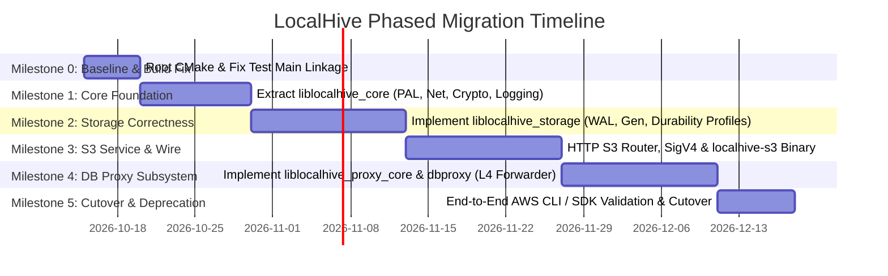

# LocalHive Incremental Migration Plan & Decision Registry
**Document ID:** `DOC-LH-MIG-007-REV2`  
**Task Reference:** `TASK LH-ARCH-001` (Phase 7 Migration Revision)  
**Date:** 2026-10-11  
**Status:** Approved Migration Roadmap (Post-Review Revision)

---

## 1. Migration Strategy & Safety Guarantees

LocalHive avoids risky "big-bang" rewrites. The migration from the existing prototype under `s3-Bucket/` to the modular native C++17 platform follows a strict **Strangler Fig Pattern**:

* **Working Code Preservation:** Existing legacy binaries and build configurations remain functional and intact throughout the early phases.
* **Side-by-Side Coexistence:** New modular components (`liblocalhive_core`, `liblocalhive_storage`, `liblocalhive_s3_core`, `liblocalhive_proxy_core`) are developed in dedicated directories alongside the legacy codebase.
* **Deterministic Rollback Gates:** Every milestone defines concrete verification criteria. If a milestone fails its verification gate, the codebase can be rolled back without impacting pre-existing capabilities.

---

## 2. Milestone Roadmap & Rollback Criteria

### Milestone 0: Build Alignment & Legacy Test Fixes
* **Objectives:**
  1. Introduce top-level `CMakeLists.txt` at repository root `e:\arison99\LocalHive`.
  2. Resolve duplicate `int main()` link collision in `s3-Bucket/tests/` by splitting test binaries (`s3_bucket_test_bucket`, `s3_bucket_test_file`, `s3_bucket_test_metadata`) or introducing a single test dispatcher.
  3. Update GitHub Actions workflows to invoke root CMake cleanly.
* **Deliverables:**
  * Root `CMakeLists.txt` and `CMakePresets.json`.
  * Fixed `s3-Bucket/CmakeLists.txt` that compiles and registers tests with CTest.
* **Verification Gate:** `ctest` runs and passes all 3 existing legacy test suites on Windows and Linux.
* **Rollback Trigger:** Inability to compile legacy `s3_bucket` executable via the root CMake file.

---

### Milestone 1: LocalHive Core Subsystem (`liblocalhive_core`)
* **Objectives:**
  1. Create directory structure `src/core/` and `include/localhive/core/`.
  2. Implement non-throwing `Result<T, Status>` and `Status` error domain.
  3. Implement `localhive::core::platform` (Win32 / POSIX abstractions for atomic replace, flush, locks).
  4. Implement lock-free asynchronous logging sink and structured logger.
  5. Implement `localhive::core::crypto` (**zero-dependency** SHA-256, HMAC-SHA256, constant-time comparison).
  6. Implement bounded thread pool with queue limits, high-watermark throttling, and backpressure.
  7. Implement `localhive::core::lifecycle` (`ServiceRunner`, `CancellationToken`).
* **Deliverables:**
  * CMake static library target `localhive_core`.
  * Unit test suite `test_core_result`, `test_core_crypto`, `test_core_platform`, `test_core_threadpool`.
* **Verification Gate:** 100% test pass rate across MSVC (Windows) and GCC/Clang (Linux).
* **Rollback Trigger:** Regressions or platform incompatibilities in platform abstractions.

---

### Milestone 2: ACID Storage Subsystem (`liblocalhive_storage`)
* **Objectives:**
  1. Create `src/storage/` and `include/localhive/storage/`.
  2. Implement `IMetadataStore` on SQLite with WAL mode, foreign keys, and generation tracking schema.
  3. Implement configurable durability profiles (`Strict`, `Standard`, `Development`).
  4. Implement `IObjectStore` with corrected write ordering (staging -> sync -> move to immutable path -> SQLite commit).
  5. Implement startup crash recovery scanner.
* **Deliverables:**
  * CMake static library target `localhive_storage`.
  * Storage integration tests verifying Invariants 1 through 5.
* **Verification Gate:** Crash simulation tests prove that aborted uploads never leave corrupt active objects and prior generations remain readable.
* **Rollback Trigger:** Data corruption or lock contention observed in SQLite WAL stress tests.

---

### Milestone 3: S3 REST Server Subsystem (`localhive-s3`)
* **Objectives:**
  1. Create `src/s3/` and `include/localhive/s3/`.
  2. Implement HTTP/1.1 S3 URI parser supporting Path-Style and Virtual-Hosted routing.
  3. Implement SigV4 signature verifier and canonical request builder using `localhive::core::crypto`.
  4. Implement XML serializers for S3 error responses, bucket lists, and `ListObjectsV2`.
  5. Enforce bounded queue backpressure: reject with HTTP 503 `SlowDown` on saturation.
  6. Assemble and link standalone executable `localhive-s3`.
* **Deliverables:**
  * Target executable `localhive-s3`.
  * Interoperability test harness using `aws s3` CLI and Python `boto3`.
* **Verification Gate:** Full test pass of basic S3 operations (`mb`, `ls`, `cp`, `rm`) using official AWS CLI with custom endpoint.
* **Rollback Trigger:** Inability to negotiate HTTP handshakes with standard AWS SDK clients.

---

### Milestone 4: Database Proxy Subsystem (`localhive-dbproxy`)
* **Objectives:**
  1. Create `src/proxy/` and `include/localhive/proxy/`.
  2. Implement `localhive::proxy::ITcpStreamForwarder` with transparent L4 bidirectional async splicing, socket backpressure, and TCP half-close handling.
  3. Implement `IRawTcpConnectPool` for pre-warming raw unallocated upstream TCP sockets.
  4. Implement `IUpstreamHealthProber` with configurable connect timeouts.
  5. Implement connection governor (concurrency ceilings and rate limiting).
  6. Assemble standalone executable `localhive-dbproxy`.
* **Deliverables:**
  * Target executable `localhive-dbproxy`.
  * End-to-end integration tests forwarding traffic to live PostgreSQL and Redis test containers.
* **Verification Gate:** Zero socket leaks, clean `FIN` propagation, and sustained throughput matching direct network connections under load.
* **Rollback Trigger:** Deadlocks under heavy downstream backpressure or dropped client sockets.

---

### Milestone 5: Production Hardening, Documentation & Cutover
* **Objectives:**
  1. Benchmark throughput and memory footprints under concurrency.
  2. Add systemd service files and Windows Service wrappers.
  3. Implement administrative security model (Named Pipe DACL on Windows, Unix domain socket mode 0600 on Linux, Bearer token on loopback HTTP).
  4. Validate end-to-end telemetry and Prometheus metrics scraping.
  5. Mark legacy `s3-Bucket/` directory as deprecated and update root documentation to point to native `localhive-s3` and `localhive-dbproxy` binaries.
* **Deliverables:**
  * Final production release candidate binaries.
  * Comprehensive developer and operations documentation.
* **Verification Gate:** Pass full end-to-end integration test matrix on both Windows and Linux CI environments.

---

## 3. Architecture Decision Records (ADRs)

| ADR ID | Decision Title | Decision / Resolution | Context & Rationale |
| :--- | :--- | :--- | :--- |
| **ADR-001** | **Boost Dependency Footprint** | Use standalone, header-only `asio.hpp` and standard C++17 `std::thread`. | Minimizes external dependency friction on Windows developer machines; avoids complex Boost build/vcpkg requirements while retaining identical Asio networking APIs. |
| **ADR-002** | **SQLite Distribution** | Vendor the official `sqlite3.c` amalgamation inside `third_party/sqlite3/`. | Eliminates pkg-config and vcpkg setup failures on Windows. Guarantees uniform SQLite version and compile flags (`SQLITE_ENABLE_WAL`) across all platforms. |
| **ADR-003** | **S3 XML Parser / Serializer** | Custom lightweight streaming XML emitter + minimal SAX parser for S3 payloads. | S3 server primarily emits XML and consumes very few incoming XML payloads (`DeleteObjects`, `CompleteMultipartUpload`). A lightweight emitter reduces binary footprint and compile times. |
| **ADR-004** | **L7 DB Protocol Interception** | Limit initial proxy release to transparent L4 TCP forwarding with connection governor. | Transparent L4 avoids premature complexity, prevents data-corrupting transaction mismanagement, and delivers robust forwarding immediately while L7 parsers are designed. |
| **ADR-005** | **Windows Service Integration** | Direct Win32 Service Control Manager (SCM) C API. | Native SCM integration allows `localhive-s3 --install-service` without requiring external third-party wrapper executables. |
| **ADR-006** | **S3 Write Ordering & Atomic Relocation** | Move physical staged file to unique immutable path `data/b_{id}/{obj}_{gen}.dat` **before** SQLite transaction commits. | Resolves Invariant 4 race condition. Committing metadata before moving the physical file created a crash window where committed metadata referenced an unwritten file. Moving the file first guarantees committed metadata always references existing data. |
| **ADR-007** | **Configurable Storage Durability Profiles** | Provide three explicit profiles: `Strict` (full sync, dir sync, WAL FULL), `Standard` (file sync, async dir sync, WAL NORMAL), `Development` (buffered I/O, WAL OFF). | Resolves SQLite WAL checkpoint power-loss ambiguity. Allows users to trade off hardware power-loss resilience against raw I/O throughput for ephemeral CI runs. |
| **ADR-008** | **Separation of L4 Forwarding from L7 Pooling** | Restrict L4 proxying to 1:1 dedicated stream splicing with backpressure; raw pool provides only pre-warmed unallocated connections. Defer M:N pooling to L7. | Without application protocol decoding, pooling or multiplexing connection streams across clients risks interleaving queries and corrupting transaction boundaries. |
| **ADR-009** | **Self-Contained Zero-Dependency Crypto** | Implement self-contained C++17 SHA-256 and HMAC-SHA256 in `localhive::core::crypto` with optional compiler intrinsics for hardware SHA-NI. | Eliminates heavyweight OpenSSL dependency; ensures frictionless builds on Windows MSVC and cross-compilation without external library linkage. |
| **ADR-010** | **Bounded Worker Queues & HTTP 503 SlowDown** | Enforce bounded work queue capacity (1024), 80% high-watermark throttling, and reject excess requests with HTTP 503 `SlowDown` S3 XML error. | Prevents unbounded thread explosion and out-of-memory crashes under traffic spikes, conforming to AWS S3 backpressure specifications. |
| **ADR-011** | **Administrative Control Plane Security Model** | Secure Windows Named Pipe with Administrator/SYSTEM DACL; secure Linux socket with `0600` permissions; require Bearer tokens on loopback HTTP. | Prevents unprivileged local user processes from tampering with daemon configuration, draining active sessions, or scraping telemetry. |
| **ADR-012** | **S3 API Compatibility vs. Universal Equivalence** | Formally define LocalHive as targeting **S3 API Compatibility** (wire protocol, REST methods, SigV4, SDKs); do not claim universal AWS S3 operational equivalence. | Establishes accurate engineering boundaries. A local native daemon cannot provide global erasure coding, multi-region replication, or planetary consistency models. |
