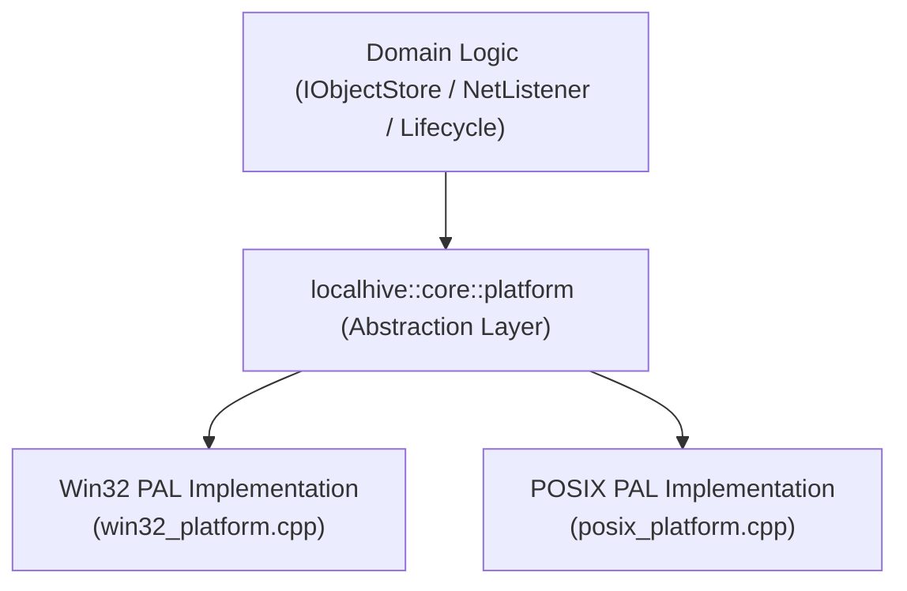

# LocalHive Platform Portability & Deployment Specification
**Document ID:** `DOC-LH-PORT-006`  
**Task Reference:** `TASK LH-ARCH-001` (Phase 6 Portability)  
**Date:** 2026-10-11  
**Status:** Portability Architecture Approved

---

## 1. Platform Matrix & Toolchain Targets

LocalHive delivers high-performance native binaries without requiring containerization. Windows is the primary development environment; Linux is the production and CI deployment target.

| Dimension | Windows (Development Target) | Linux (Production Target) |
| :--- | :--- | :--- |
| **Operating System** | Windows 10 / 11 / Server 2019+ (x86_64) | Ubuntu 22.04 LTS / Debian 12 / RHEL 9 (x86_64, aarch64) |
| **Supported Compilers** | MSVC 2019/2022 (v142/v143), MinGW64 GCC 10+ | GCC 9+, Clang 11+ |
| **C++ Standard** | ISO C++17 (`/std:c++17` on MSVC) | ISO C++17 (`-std=c++17` on GCC/Clang) |
| **Build Generator** | Visual Studio 16/17, Ninja, MinGW Makefiles | Ninja, Unix Makefiles |
| **Execution Environment** | Standalone Windows Executable / Windows Service | Native Daemon / systemd Service Unit |
| **Testing Evidence Status** | **MinGW GCC build artifact verified** (`s3-Bucket/build/s3_bucket.exe`); **MSVC CMake build requires remediation**. | **Unverified in current repository session** (requires Linux runner / CI execution). |

> [!IMPORTANT]
> **Portability Rule:** We strictly distinguish between verified platform evidence and targeted platform architectures. Linux execution and MSVC CMake builds are architectural targets designed for compatibility, but have not been compiled in this Windows workspace session.

---

## 2. Dependency Discovery & Modern CMake Strategy

The legacy build system failed on Windows MSVC due to hardcoded `-lpthread` and brittle `pkg-config` queries. The unified CMake architecture replaces this with standard CMake discovery modules and platform guards:

```cmake
cmake_minimum_required(VERSION 3.16)
project(LocalHive LANGUAGES C CXX)

set(CMAKE_CXX_STANDARD 17)
set(CMAKE_CXX_STANDARD_REQUIRED ON)
set(CMAKE_CXX_EXTENSIONS OFF)

# 1. Threads (Cross-Platform)
set(THREADS_PREFER_PTHREAD_FLAG ON)
find_package(Threads REQUIRED)

# 2. Boost (Asio & System)
find_package(Boost 1.70 REQUIRED COMPONENTS system)

# 3. SQLite3
# Prefer official CMake module; provide vendored amalgamation fallback if missing
find_package(SQLite3 QUIET)
if(NOT SQLite3_FOUND)
    message(STATUS "System SQLite3 not found. Utilizing vendored amalgamation.")
    add_subdirectory(third_party/sqlite3)
endif()

# 4. Networking Sockets (Windows Specific)
if(WIN32)
    set(PLATFORM_NET_LIBS ws2_32 wsock32)
else()
    set(PLATFORM_NET_LIBS "")
endif()
```

### CMake Presets (`CMakePresets.json`)
LocalHive provides standardized build presets to ensure consistent multi-platform builds:
* `windows-msvc-debug`: MSVC compiler, multi-threaded debug DLL runtime (`/MDd`), debug symbols.
* `windows-msvc-release`: MSVC compiler, `/O2`, `/MD`, whole-program optimization (`/GL`).
* `windows-mingw-release`: MinGW-w64 GCC, `-O3 -DNDEBUG`, static libgcc/libstdc++.
* `linux-gcc-release`: GCC compiler, `-O3 -DNDEBUG -march=x86-64-v2`.
* `linux-clang-debug`: Clang compiler, AddressSanitizer (`-fsanitize=address,undefined`).

---

## 3. OS Primitives & Platform Abstraction Layer

All OS-specific system calls are isolated within `localhive::core::platform`. Direct calls to `windows.h` or `sys/*.h` in domain code are strictly prohibited.



### 3.1. Filesystem Durability & Disk Flushing
* **Windows:**
  ```cpp
  bool flush_file_buffers(void* os_handle) {
      return ::FlushFileBuffers(reinterpret_cast<HANDLE>(os_handle)) != 0;
  }
  ```
* **Linux:**
  ```cpp
  bool flush_file_buffers(int fd) {
      return ::fdatasync(fd) == 0;
  }
  ```

### 3.2. Atomic File Replacement
* **Windows:** Uses `ReplaceFileW()` to replace target files atomically. When staging files must be moved into empty slots, `MoveFileExW(..., MOVEFILE_REPLACE_EXISTING | MOVEFILE_WRITE_THROUGH)` is invoked.
* **Linux:** Uses `rename(oldpath, newpath)` which is atomic by POSIX definition. On Linux 3.15+, `renameat2(AT_FDCWD, oldpath, AT_FDCWD, newpath, 0)` is used to guarantee atomic swap semantics.

### 3.3. File Locking
* **Windows:** Advisory/mandatory locks via `LockFileEx(hFile, LOCKFILE_EXCLUSIVE_LOCK, 0, MAXDWORD, MAXDWORD, &overlapped)`.
* **Linux:** Advisory locks via `fcntl(fd, F_SETLK, &flock_struct)` or `flock(fd, LOCK_EX)`.

### 3.4. Path Encoding & Normalization
* **Windows:** All internal paths are UTF-8. Prior to calling Win32 APIs, paths are converted to `wchar_t` (`std::wstring`) using `MultiByteToWideChar` and prefixed with `\\?\` where necessary to support paths exceeding 260 characters (`MAX_PATH`).
* **Linux:** Native UTF-8 paths are used directly with standard POSIX APIs. Forward slashes (`/`) are canonical on all platforms.

---

## 4. Signal Handling, Console Events & Lifecycle

Orderly shutdown requires trapping OS-specific process interruption events and propagating them to `CancellationToken`:

```cpp
namespace localhive::core::platform {

void register_signal_handler(std::function<void()> on_shutdown_signal) {
#if defined(_WIN32)
    static std::function<void()> shutdown_cb = on_shutdown_signal;
    ::SetConsoleCtrlHandler([](DWORD ctrl_type) -> BOOL {
        switch (ctrl_type) {
            case CTRL_C_EVENT:
            case CTRL_BREAK_EVENT:
            case CTRL_CLOSE_EVENT:
            case CTRL_SHUTDOWN_EVENT:
                if (shutdown_cb) shutdown_cb();
                return TRUE;
            default:
                return FALSE;
        }
    }, TRUE);
#else
    static std::function<void()> shutdown_cb = on_shutdown_signal;
    struct sigaction sa{};
    sa.sa_handler = [](int sig) {
        if (shutdown_cb) shutdown_cb();
    };
    sigemptyset(&sa.sa_mask);
    sa.sa_flags = 0;
    sigaction(SIGINT, &sa, nullptr);
    sigaction(SIGTERM, &sa, nullptr);
    sigaction(SIGHUP, &sa, nullptr); // Configuration reload trigger
#endif
}

} // namespace localhive::core::platform
```

---

## 5. Linux Production Deployment (systemd)

For production Linux deployments, LocalHive runs as an unprivileged system daemon.

### 5.1. S3 Daemon Service Unit (`/etc/systemd/system/localhive-s3.service`)
```ini
[Unit]
Description=LocalHive S3 Object Storage Service
Documentation=https://github.com/Arison99/LocalHive
After=network.target local-fs.target

[Service]
Type=simple
User=localhive
Group=localhive
ExecStart=/usr/local/bin/localhive-s3 --config /etc/localhive/s3.json
Restart=always
RestartSec=5s

# Process & Resource Sandboxing
LimitNOFILE=65536
LimitNPROC=4096
TasksMax=4096
MemoryHigh=2G
MemoryMax=4G

# Security Hardening
ProtectSystem=strict
ProtectHome=true
ReadWritePaths=/var/lib/localhive/s3
ProtectKernelTunables=true
ProtectControlGroups=true
PrivateTmp=true
NoNewPrivileges=true

# Graceful Drain Timeout
TimeoutStopSec=30s
KillSignal=SIGTERM

[Install]
WantedBy=multi-user.target
```

### 5.2. DB Proxy Service Unit (`/etc/systemd/system/localhive-dbproxy.service`)
```ini
[Unit]
Description=LocalHive Database Connector Proxy
Documentation=https://github.com/Arison99/LocalHive
After=network.target

[Service]
Type=simple
User=localhive
Group=localhive
ExecStart=/usr/local/bin/localhive-dbproxy --config /etc/localhive/dbproxy.json
Restart=always
RestartSec=5s

LimitNOFILE=131072
TasksMax=8192
TimeoutStopSec=45s
KillSignal=SIGTERM

[Install]
WantedBy=multi-user.target
```
