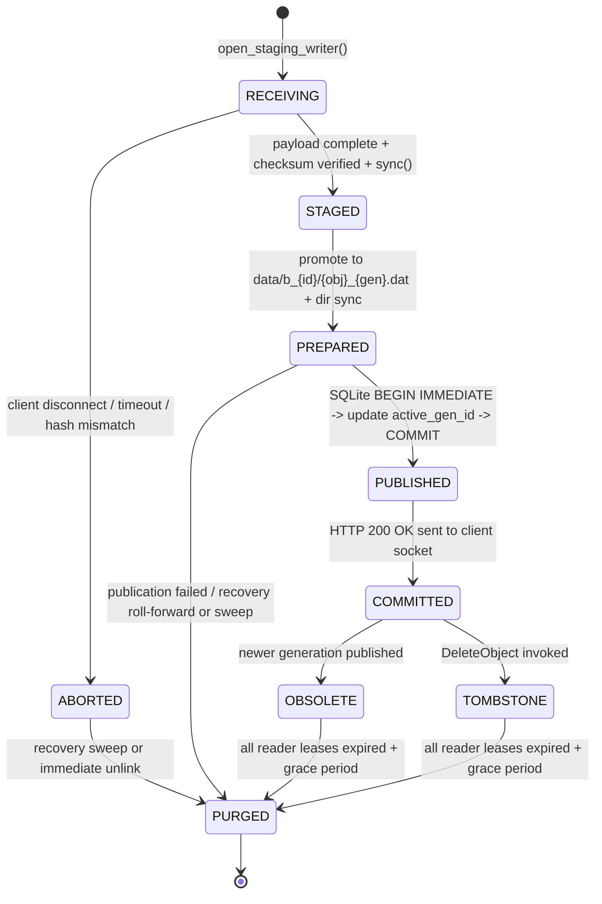

# LocalHive S3 Storage & Durability Specification
**Document ID:** `DOC-LH-STORAGE-004-REV3`  
**Task Reference:** `TASK LH-ARCH-002` (Normative Storage Contract Closure)  
**Date:** 2026-10-12  
**Status:** Normative Engineering Contract

---

## 1. Storage Architecture Overview

The LocalHive S3 storage engine provides deterministic single-object atomic publication, reader isolation, and crash consistency for local object operations. Naive in-place file replacement (`std::ofstream` truncation) is replaced by an **Immutable Generation Storage Engine** coordinated with an embedded SQLite metadata store in **Write-Ahead Logging (WAL)** mode.

> [!IMPORTANT]
> **Filesystem & Operating System Assumptions:**
> 1. **POSIX / NTFS Semantics:** The storage directory must reside on a local filesystem supporting atomic rename operations within a single filesystem mount (NTFS on Windows; ext4, XFS, or Btrfs on Linux). Cross-device moves (`EXDEV`) are prohibited between `.staging/` and `data/`.
> 2. **No Distributed Claims:** LocalHive makes no claims of distributed consensus, multi-node erasure coding, or cross-datacenter replication. All guarantees apply strictly to single-node host storage.

---

## 2. Namespace & Physical Layout

### 2.1. Logical vs. Physical Namespace
* **Logical Key Identity:** Client-provided `{bucket_name}/{object_key}`.
  * Keys are arbitrary UTF-8 strings up to 1024 bytes, supporting delimiter `/`.
  * Path separators are normalized to forward slashes (`/`).
* **Physical Identity:** Decoupled from the logical key to eliminate path-traversal vulnerabilities (`../`), Windows reserved device names (`CON`, `PRN`, `AUX`, `NUL`), and filesystem maximum path limits (`MAX_PATH = 260`):
  * **Bucket ID (`bucket_id`):** 64-bit unsigned integer assigned upon bucket creation.
  * **Object ID (`object_id`):** 64-bit unsigned integer assigned upon first key insertion.
  * **Generation ID (`gen_id`):** Monotonically increasing 64-bit timestamped integer (`(unix_epoch_ms << 20) | sequence_counter`).
  * **Physical Object Path:** `data/b_{bucket_id}/{object_id}_{gen_id}.dat`. Because every generation has a globally unique physical path, **writes never overwrite existing files in place**.

### 2.2. Directory Layout on Disk
```
{storage_root}/
├── metadata.db             # Primary SQLite metadata database
├── metadata.db-wal         # SQLite Write-Ahead Log
├── metadata.db-shm         # SQLite Shared Memory index
├── .staging/               # Quarantine area for in-flight uploads
│   └── b_00000001/         # Partitioned by bucket_id
│       ├── g_18b49a21.tmp  # In-flight temporary stream (RECEIVING)
│       └── g_18b49a22.tmp
└── data/                   # Durable, immutable committed objects
    └── b_00000001/         # Partitioned by bucket_id
        ├── 00000042_18b49a20.dat # Active object generation (COMMITTED)
        └── 00000042_18b49980.dat # Obsolete generation (OBSOLETE; held by reader)
```

---

## 3. Normative Object-Write Lifecycle

Every object write operation traverses a strict, 5-state state machine:



### Transition Specifications

| State Transition | Persistent State & Artifacts | Failure Behavior & Recovery | Retry Semantics | Metadata & Visibility | Reclamation Conditions |
| :--- | :--- | :--- | :--- | :--- | :--- |
| **`[*] → RECEIVING`** | Physical file `.staging/b_{id}/g_{gen}.tmp` created. `generations` table has row `(gen_id, state='receiving')`. | Client drops socket or timeout triggers: Staging file abandoned. Marked `aborted`. | Client may retry immediately with a new PUT request (new `gen_id`). | Completely invisible to all readers. `objects.active_gen_id` unchanged. | Swept if file modification age > `staging_grace_period_sec` (default 3600s). |
| **`RECEIVING → STAGED`** | Stream complete; payload size matches `Content-Length`. Checksums (SHA-256, MD5) validated. Staging file synced via `IStreamWriter::sync()`. | Disk write failure or checksum mismatch: file deleted immediately; HTTP 400 or 500 returned. | Safe to retry with new request. | Invisible to readers. `generations.state = 'staged'`. | Swept on startup recovery if unreferenced. |
| **`STAGED → PREPARED`** | Staged file moved into final immutable path: `data/b_{id}/{obj}_{gen}.dat`. Directory metadata flushed. | OS move failure: staging file unlinked; HTTP 500 returned. | Safe to retry. | File exists on disk, but `objects.active_gen_id` STILL points to prior generation. Invisible to readers. | Swept on startup recovery if SQLite does not advance to `published`. |
| **`PREPARED → PUBLISHED`** | SQLite transaction commits (`BEGIN IMMEDIATE`): `objects.active_gen_id = gen_id`, `generations.state = 'published'`, prior gen set to `'obsolete'`. | Transaction rollback or crash: prior generation remains active. Physical file in `data/` cleaned up on startup. | Safe to retry. | **Atomically visible.** Any new `GetObject` request arriving after SQLite commit sees the new generation. | Prior generation marked `obsolete`; retained until reader lease count reaches 0. |
| **`PUBLISHED → COMMITTED`** | Client receives `HTTP/1.1 200 OK` with `ETag` and `x-amz-version-id`. Database updates `generations.state = 'committed'`. | Network drop while sending 200 OK: Data is already durable and active in LocalHive. | Client retry will create another generation, superseding this one cleanly. S3 PUT is idempotent. | Fully active and visible. | Current generation protected against reclamation while `active_gen_id == gen_id`. |

---

## 4. Concurrent Operations & Edge Case Resolution

### 4.1. Concurrent PUTs to the Same Bucket and Key
* **Scenario:** Client A and Client B concurrently issue `PUT /my-bucket/report.pdf`.
* **Execution:**
  1. Client A allocates `gen_id = 1001`; streams to `.staging/b_1/g_1001.tmp`.
  2. Client B allocates `gen_id = 1002`; streams to `.staging/b_1/g_1002.tmp`.
  3. Both complete streams, flush write caches, and relocate to:
     * `data/b_1/obj_42_1001.dat`
     * `data/b_1/obj_42_1002.dat`
  4. Publication serialization occurs via SQLite's dedicated write queue (`BEGIN IMMEDIATE`):
     * Transaction 1 commits `active_gen_id = 1001`.
     * Transaction 2 commits `active_gen_id = 1002`, marking `gen_id = 1001` as `obsolete`.
* **Invariant:** Neither upload corrupts or blocks the other. Standard S3 last-writer-wins consistency is preserved. Readers holding open streams to generation 1001 continue reading without error.

### 4.2. Client Disconnect After Ambiguous Network Response
* **Scenario:** Client uploads complete payload, LocalHive commits the metadata, but the TCP connection resets before the client receives `HTTP 200 OK`.
* **Client Behavior:** S3 clients/SDKs retry the `PUT` request with exponential backoff.
* **LocalHive Guarantee:** The retry executes as a brand new request with a new `gen_id`. The publication protocol cleanly commits the retry and retires the previous generation. No partial state, torn writes, or duplicate key errors occur.

### 4.3. Crash Recovery Matrix

| Crash Point | Filesystem State | SQLite State | Startup Recovery Action | Visible Result |
| :--- | :--- | :--- | :--- | :--- |
| **During `RECEIVING`** | Incomplete `.staging/` file | `state = 'receiving'` | Startup scanner detects uncommitted staging file older than grace period; unlinks file and purges DB row. | Clean rollback; no partial object visible. |
| **During `PREPARED`** | File in `data/`, but uncommitted | `active_gen_id` points to old gen; new gen `state = 'prepared'` | Startup recovery checks `objects.active_gen_id`. Because new `gen_id` was never committed, physical file is unlinked. | Clean rollback; prior generation remains active. |
| **Immediately after SQLite `COMMIT`** | File in `data/` | `active_gen_id` points to new gen; `state = 'published'` | SQLite WAL replays transaction. Recovery scanner validates physical file exists in `data/`. Status promoted to `'committed'`. | Publication persists; new generation is active. Zero dangling metadata. |

---

## 5. Configurable Durability Profiles

LocalHive provides three explicit durability levels:

```mermaid
graph TD
    subgraph StrictProfile ["Profile: Strict"]
        S_File["fdatasync / FlushFileBuffers (Per File)"]
        S_Dir["fsync parent dir (Linux) / Write-Through (Win)"]
        S_WAL["SQLite PRAGMA synchronous = FULL"]
        S_File --> S_Dir --> S_WAL
    end

    subgraph StandardProfile ["Profile: Standard (Default)"]
        Std_File["fdatasync / FlushFileBuffers (Per File)"]
        Std_Dir["OS Async Directory Flush"]
        Std_WAL["SQLite PRAGMA synchronous = NORMAL"]
        Std_File --> Std_Dir --> Std_WAL
    end

    subgraph DevProfile ["Profile: Development"]
        D_File["OS Buffered Write (No hardware sync)"]
        D_Dir["OS Async Directory Flush"]
        D_WAL["SQLite PRAGMA synchronous = OFF"]
        D_File --> D_Dir --> D_WAL
    end
```



### Detailed Guarantees & Operating Parameters

| Parameter / Behavior | `Strict` Profile | `Standard` Profile *(Default)* | `Development` Profile |
| :--- | :--- | :--- | :--- |
| **SQLite `synchronous`** | `FULL` | `NORMAL` | `OFF` |
| **Payload Sync** | `FlushFileBuffers` / `fdatasync` | `FlushFileBuffers` / `fdatasync` | None (OS write cache buffered) |
| **Directory Metadata Sync** | `fsync(dir_fd)` (Linux) / `MOVEFILE_WRITE_THROUGH` (Windows) | Asynchronous OS flush | Asynchronous OS flush |
| **Power-Loss Guarantee** | **Guaranteed.** Host power loss will not lose or corrupt committed objects. | **Process-crash resilient.** Host power loss may revert WAL frames committed within the last WAL checkpoint interval (default: 1000 pages). | **None.** Host power loss or process kill may corrupt recent writes. |
| **WAL Checkpoint Behavior** | Synchronous checkpoint on interval and shutdown. | Passive background checkpointing. | Passive background checkpointing. |
| **Recommended Use** | Production daemon, CI artifact persistence, benchmark audits. | Default developer workstation, integration tests. | Fast unit tests, disposable ephemeral test containers. |

---

## 6. SQLite Concurrency, Serialization & WAL Checkpointing

1. **Serialized Write Loop:**
   * SQLite supports concurrent readers, but only **one writer at a time**.
   * To prevent `SQLITE_BUSY` errors under high concurrent write load, all write transactions (`BEGIN IMMEDIATE`) are marshaled through a single dedicated worker thread (`localhive::core::SqliteWriteWorker`).
   * Bounded busy handling: If direct queries encounter contention, `sqlite3_busy_timeout` is configured to 5,000 ms with exponential backoff.
2. **Reader Concurrency:**
   * Reader threads execute `SELECT` queries across pooled read-only SQLite connections concurrently without acquiring writer locks.
3. **WAL Checkpointing Strategy:**
   * **Passive Checkpoint:** Triggered when WAL reaches 1,000 pages (approx. 4 MB). Executed via `sqlite3_wal_checkpoint_v2(db, nullptr, SQLITE_CHECKPOINT_PASSIVE, ...)` without interrupting active readers.
   * **Restart Checkpoint:** Executed during idle periods when active connection count drops to zero.
   * **Shutdown Checkpoint:** Executed during graceful service stop via `SQLITE_CHECKPOINT_TRUNCATE` to merge all WAL frames back into `metadata.db` and truncate the log.

---

## 7. OS Filesystem Portability Guarantees

LocalHive encapsulates all platform differences inside `localhive::core::platform`:

| Operation | Windows (NTFS) Implementation | Linux (POSIX / ext4 / XFS) Implementation |
| :--- | :--- | :--- |
| **Atomic Relocation (`PREPARED`)** | `MoveFileExW(old, new, MOVEFILE_WRITE_THROUGH)` to unallocated target path. | `rename(old, new)` or `renameat2(..., 0)`. |
| **Hardware Buffer Flush** | `FlushFileBuffers(hFile)`. Returns `FALSE` on failure. | `fdatasync(fd)`. Returns -1 on failure (`errno`). |
| **Directory Entry Flush** | Windows NTFS commits directory entries on handle close when `MOVEFILE_WRITE_THROUGH` is used. | `open(dir, O_DIRECTORY)` followed by `fsync(dir_fd)` and `close(dir_fd)`. |
| **Deleting Open / Read Files** | File handles opened with `FILE_SHARE_READ \| FILE_SHARE_DELETE`. Unlinking uses `SetFileInformationByHandle` with `FILE_DISPOSITION_FLAG_POSIX_SEMANTICS`. | Native POSIX `unlink()`. Directory entry removed immediately; physical disk space freed when last reader closes file descriptor. |
| **File Locking** | Advisory locking via `LockFileEx`. | Advisory locking via `fcntl(fd, F_SETLK, ...)`. |
