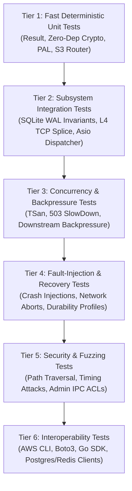

# LocalHive Comprehensive Verification & Testing Strategy
**Document ID:** `DOC-LH-TEST-008-REV2`  
**Task Reference:** `TASK LH-ARCH-001` (Phase 7 Testing Revision)  
**Date:** 2026-10-11  
**Status:** Verification Strategy Approved (Post-Review Revision)

---

## 1. Testing Philosophy & Verification Framework

LocalHive enforces a rigorous, multi-tiered testing methodology designed to treat the codebase as an adversary. Happy-path demonstrations are insufficient; every contract must be proven under boundary conditions, high concurrency, network partitions, and process crashes.

> [!IMPORTANT]
> **API Compatibility vs. Universal Equivalence:**  
> Testing validates wire-level **S3 API Compatibility** (HTTP REST verbs, SigV4 authentication, XML error serialization, AWS CLI / Boto3 SDK compatibility). Tests shall not fabricate or imply distributed cluster equivalence.

---

## 2. Currently Runnable Baseline vs. Future Test Matrix

| Test Identifier | Category | Current Execution Status | Evidence / Notes |
| :--- | :--- | :--- | :--- |
| **`simple_test.cpp`** | Integration Sanity | **Currently Runnable** | Self-contained translation unit. Verifies standalone `BucketManager::createBucket` and `FileOperations::uploadFile`. |
| **`test_client.py`** | E2E HTTP Script | **Currently Runnable** | Python test client using `requests`. Exercises running `s3_bucket.exe` on port 8080. |
| **`tests/bucket_test.cpp`** | Unit | **Fails Combined Link** | Defines `int main()`. Runnable only if compiled in isolation. |
| **`tests/file_test.cpp`** | Unit | **Fails Combined Link** | Defines `int main()`. Runnable only if compiled in isolation. |
| **`tests/metadata_test.cpp`** | Unit | **Fails Combined Link** | Defines `int main()`. Runnable only if compiled in isolation. |
| **`Core Crypto Suite`** | Unit (Tier 1) | **Future (Milestone 1)** | Tests zero-dependency SHA-256 and HMAC-SHA256 against RFC 4231 & RFC 6234 vectors. |
| **`Queue Backpressure Suite`**| Concurrency (Tier 3)| **Future (Milestone 1)** | Tests queue saturation, 80% watermark, and HTTP 503 `SlowDown` rejection. |
| **`Storage Invariant Suite`**| Integration (Tier 2)| **Future (Milestone 2)** | Tests Invariants 1–5, SQLite WAL recovery, generational state machine. |
| **`Durability Profile Suite`**| Fault-Injection (Tier 4)| **Future (Milestone 2)** | Asserts power-loss resilience across `Strict`, `Standard`, and `Development` levels. |
| **`L4 TCP Splice Suite`** | Integration (Tier 2)| **Future (Milestone 4)** | Tests transparent 1:1 stream splicing, backpressure, and half-close `FIN` propagation. |
| **`Admin IPC Security Suite`**| Security (Tier 5) | **Future (Milestone 5)** | Tests Windows Named Pipe DACL, Linux socket permissions (0600), and Bearer tokens. |
| **`AWS CLI / Boto3 Suite`** | Interop (Tier 6) | **Future (Milestone 3)** | Executes official AWS CLI / SDK against custom endpoint. |

---

## 3. Tiered Testing Strategy Details

### 3.1. Tier 1: Unit Testing (Deterministic & Sub-Millisecond)
* **Framework:** Standard C++ test framework (Catch2 or lightweight bespoke test harness).
* **Scope:**
  * **Result & Error Domain:** Validate monadic transformations, value unwrap, error code comparison, and zero-allocation characteristics.
  * **Zero-Dependency Crypto:** Validate clean-room SHA-256 and HMAC-SHA256 against official RFC 6234 / RFC 4231 test vectors. Verify `constant_time_equals` against timing attacks.
  * **Platform PAL:** Validate that `localhive::core::platform` correctly encodes UTF-8 to UTF-16 on Windows, normalizes paths, and sets file sharing flags.
  * **S3 URI & Router:** Test extraction of bucket and key from both Path-Style (`/bucket/key`) and Virtual-Hosted Style (`Host: bucket.localhost`). Verify parameter sorting and percent-decoding.

### 3.2. Tier 2: Subsystem Integration Testing
* **Storage Correctness:**
  * Exercise real SQLite databases in WAL mode under different durability profiles (`Strict`, `Standard`, `Development`).
  * Validate that `commit_staged_object` verifies physical file presence before committing metadata.
  * Verify `list_objects` returns correctly sorted keys with pagination markers.
* **Transparent L4 TCP Forwarding & Splice:**
  * Spin up local mock TCP echo and sink servers.
  * Forward 100 MB of random data through `ITcpStreamForwarder`. Verify byte-for-byte fidelity via SHA-256 comparison.
  * Verify half-close behavior: client sending `shutdown(SHUT_WR)` triggers upstream `SHUT_WR` while remaining open for response reception.

### 3.3. Tier 3: Concurrency & Backpressure Testing
* **Reader / Writer Contention Test:**
  * Spin up 50 concurrent reader threads continuously executing `GetObject` on key `data.bin`.
  * Simultaneously run 5 writer threads continuously executing `PutObject` overwriting `data.bin` with new random payloads.
  * **Assertion:** No reader ever reads a torn or mixed generation payload; every read completes with an exact checksum match for either the old or the new generation.
* **Worker Queue Saturation & Backpressure:**
  * Flood S3 server with requests exceeding worker queue capacity (1024 tasks).
  * **Assertion:** Daemon returns `HTTP/1.1 503 Service Unavailable` with XML error `SlowDown` without crashing or corrupting state.
* **Sanitizer Harness:** Run full test suite under Clang **ThreadSanitizer (TSan)** and **AddressSanitizer (ASan)** on Linux CI runners.

### 3.4. Tier 4: Fault-Injection & Durability Recovery Testing
* **Mid-Stream Network Disconnect:**
  * Client sends HTTP headers and half of the payload, then forcefully terminates TCP connection (`SO_LINGER = 0`).
  * **Assertion:** Verify that the truncated file remains in `.staging` marked as `aborted` and is never committed to active metadata.
* **Simulated Crash During Publication (ADR-006 Corrected Protocol):**
  * Inject a synthetic crash immediately following the physical file move to `data/` but *before* the SQLite transaction commits.
  * Trigger server restart.
  * **Assertion:** The startup recovery scanner detects the uncommitted staged file in `data/`, removes it, and leaves the prior active generation completely intact.
* **Durability Level Verification:**
  * Simulate hard power cut / process termination under `Strict` profile. Verify SQLite WAL replay and hardware flush integrity.

### 3.5. Tier 5: Security & Administrative Access Testing
* **Path-Traversal Injection:**
  * Submit requests with adversarial keys: `../../etc/passwd`, `..\..\Windows\System32\cmd.exe`, `bucket/../../../secret`, `/bucket/%2e%2e%2f%2e%2e%2fconfig.json`.
  * **Assertion:** Router rejects with `400 InvalidArgument` or `404 NoSuchKey`; no filesystem path escapes the allocated sandbox directory.
* **Administrative IPC Access Control:**
  * Windows: Spawn non-administrator process attempting to open `\\.\pipe\localhive-s3-admin`. Assert failure with Win32 `ERROR_ACCESS_DENIED`.
  * Linux: Run process as unprivileged user attempting to open `/var/run/localhive/s3-admin.sock`. Assert failure with `EACCES`.
  * Loopback HTTP: Attempt request to `127.0.0.1:9090` without token or with invalid token. Assert HTTP 401 Unauthorized.

### 3.6. Tier 6: Interoperability Testing (Real-World Tooling)
* **AWS CLI Harness:** Automated script executing `aws s3 mb`, `aws s3 cp`, `aws s3 ls`, `aws s3 sync`, and `aws s3 rm` against `http://localhost:8080`.
* **Python Boto3 Test Suite:** Automated pytest suite executing object uploads, presigned URL generation, and exception handling against the LocalHive S3 endpoint.
* **Database Driver Suite:** Automated tests connecting standard `psql` (PostgreSQL) and `redis-cli` clients through `localhive-dbproxy`.
